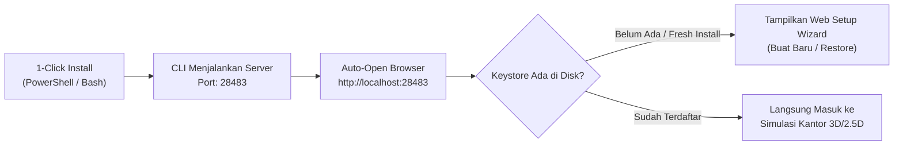
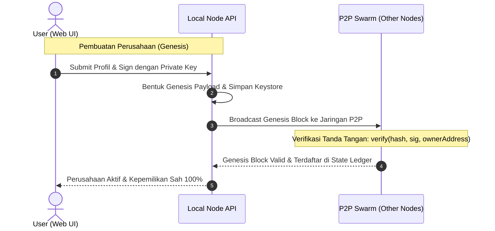
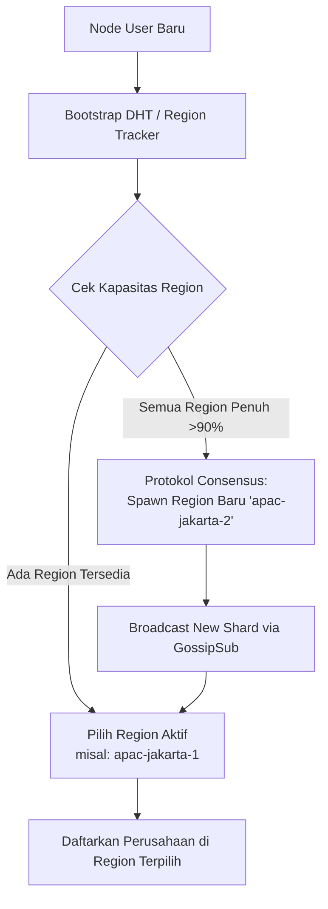
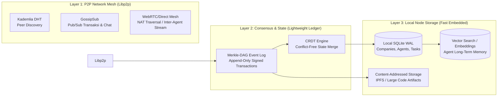

# Arsitektur Node-to-Node (P2P Blockchain) untuk CEO Virtual

Dokumen ini menjelaskan rancangan arsitektur terdesentralisasi (*peer-to-peer / blockchain-like*) untuk **CEO Virtual**, mencakup manajemen identitas (*wallet/seed phrase*), bukti kepemilikan perusahaan kriptografis (*ownership verification*), partisi region dinamis (*auto-sharding*), sistem database node-to-node yang efisien, serta alur **Web-First Interactive Onboarding & Recovery**.

---

## 1. Alur Setup Pertama Kali & Pemulihan Akun (Web-First Interactive Onboarding)

Untuk kenyamanan pengguna dan menghindari kerumitan terminal CLI, seluruh proses inisialisasi identitas, pencatatan kode cadangan, pemilihan region, hingga peluncuran kantor dilakukan melalui **Antarmuka Web Interaktif**.

### 1.1 Alur Otomatis dari CLI ke Web Browser



1. **Auto-Launch Browser**: Begitu instalasi CLI selesai (`install.ps1` atau `install.sh`) atau saat perintah `ceo-virtual start` dijalankan, server daemon aktif dan CLI otomatis membuka browser default ke `http://localhost:28483`.
2. **Deteksi Status Node**: Web frontend memeriksa status node ke endpoint `/api/node/status`. Jika belum ada identitas pemilik (file `~/.ceo-virtual/keystore.json` kosong), halaman langsung menyajikan **Interactive Setup Wizard**.

---

### 1.2 Langkah-Langkah Web Setup Wizard

```
+---------------------------------------------------------------------------------+
|                         👑 CEO VIRTUAL INITIALIZATION                           |
|               Autonomous Multi-Agent Workplace on Decentralized P2P             |
+---------------------------------------------------------------------------------+
|                                                                                 |
|   [ 🚀 Buat Kantor Baru ]                      [ 🔄 Pulihkan Kantor ]           |
|   (Create New Company & Wallet)                (Restore from Backup File)       |
|                                                                                 |
+---------------------------------------------------------------------------------+
```

#### A. Alur Pembuatan Kantor Baru (New Company & Identity)
1. **Generasi Kunci Kriptografi di Web**:
   - Sistem membangkitkan **BIP-39 Mnemonic Seed Phrase (12 kata rahasia)** dan **Public Address** (misal: `0x7aB9...3F1c`).
2. **Tampilan Kartu Kata Interaktif**:
   - 12 kata disajikan dalam kotak-kotak bernomor yang rapi dan elegan dengan tombol reveal/hide.
3. **Penyimpanan Kode Cadangan Cepat & Aman**:
   - 📋 **Tombol "Salin Kode Cadangan" (Copy to Clipboard)**: Menyalin seluruh 12 kata ke clipboard dalam 1 klik disertai notifikasi toast visual.
   - 📥 **Tombol "Unduh Kode Cadangan (.txt)" (Download Backup)**: Otomatis mengunduh file teks (contoh: `ceo-virtual-backup-2026.txt`) berformat:
     ```text
     ======================================================================
     👑 CEO VIRTUAL - KODE CADANGAN PEMULIHAN KANTOR (PRIVATE RECOVERY)
     ======================================================================
     Node Address  : 0x7aB9c54D8fE28A1702951C9EbDa174823F1c
     Tanggal Dibuat: 2026-10-22 15:00 WIB
     
     12 KATA KUNCI PEMULIHAN (SEED PHRASE):
     matrix dynamic ocean quantum timber harvest rocket velvet whisper orbit shield alpha
     
     PENTING & RAHASIA:
     - Jangan bagikan file ini kepada siapapun!
     - Simpan file ini di tempat aman (Flashdisk / Password Manager).
     - Jika PC Anda di-install ulang atau Anda berganti perangkat, cukup 
       upload file ini pada menu Setup Web CEO Virtual.
     ======================================================================
     ```
4. **Validasi**: Pengguna mencentang checkbox *"Saya sudah mengunduh dan menyimpan kode cadangan ini dengan aman"* sebelum tombol lanjut aktif.

#### B. Alur Pemulihan Kantor (Restore from Backup)
Jika pengguna berpindah PC atau baru saja install ulang OS:
1. **Upload / Drag & Drop File Cadangan (.txt)**: Pengguna cukup menarik file `.txt` cadangan yang pernah diunduh ke area drop-zone. Sistem otomatis mengekstrak 12 kata dan memvalidasi formatnya.
2. **Opsi Paste Manual**: Pengguna juga bisa langsung mem-paste 12 kata ke area text area yang disediakan.
3. **Instant Reconstruct**: Node merekonstruksi *Private Key* dan menyinkronkan seluruh profil perusahaan, data agen, dan saldo dari jaringan P2P.

---

### 1.3 Pemilihan Region Jaringan Visual

Setelah tahap identitas selesai, pengguna memilih klaster region untuk koneksi node:

```
+---------------------------------------------------------------------------------+
|  🌐 Pilih Region Node Jaringan                                                  |
|  Tentukan klaster terdekat untuk komunikasi real-time P2P antar agen & node     |
+---------------------------------------------------------------------------------+
|  [✓] 🇮🇩 APAC Jakarta Shard-1      [Latency: 12ms]   ● Optimal  (84/100 Slot)   |
|  [ ] 🇸🇬 APAC Singapore Shard-1    [Latency: 28ms]   ● Tersedia (91/100 Slot)   |
|  [ ] 🇯🇵 APAC Tokyo Shard-1        [Latency: 75ms]   ● Lengang  (45/100 Slot)   |
|  [ ] 🇺🇸 US East Shard-1           [Latency: 185ms]  ● Lengang  (30/100 Slot)   |
+---------------------------------------------------------------------------------+
|  💡 Auto-Scaling Info: Jika seluruh region penuh (≥90%), protokol konsensus     |
|     akan otomatis men-spawn shard region baru (misal: APAC Jakarta Shard-2).    |
+---------------------------------------------------------------------------------+
```

---

### 1.4 Profil Perusahaan & Peluncuran Kantor
1. Input Nama Kantor/Perusahaan (misal: *Nusantara AI Tech*).
2. Pilih Industri: *Software Engineering, Digital Agency, Game Studio, Content House, Consulting*.
3. Klik tombol **🚀 Luncurkan Kantor Virtual (Launch Office)**:
   - Sistem menandatangani transaksi **Genesis Block** dengan Private Key.
   - Keystore terenkripsi disimpan di disk lokal `~/.ceo-virtual/keystore.json`.
   - Browser otomatis beralih ke simulasi kantor virtual 3D/2.5D.

---

## 2. Cara Mengetahui & Membuktikan Kepemilikan Perusahaan (Proof of Ownership)

Pada paradigma blockchain, **kepemilikan tidak ditentukan oleh akun email/password di database pusat**, melainkan oleh **Asymmetric Cryptography (Tanda Tangan Digital)**.



### Struktur Genesis Block Perusahaan
```json
{
  "txType": "COMPANY_GENESIS",
  "companyId": "cmp_8fa910d2c34",
  "name": "DevNexus Labs",
  "industry": "Software Engineering",
  "regionId": "apac-jakarta-1",
  "ownerAddress": "0x7aB9c54D8fE28A1702951C9EbDa174823F1c",
  "createdAt": 1729582800000,
  "nonce": 1,
  "signature": "0x3045022100e4b8a21f... (Tanda tangan dari Private Key Owner)"
}
```

### Mekanisme Validasi Kepemilikan:
1. **Verifikasi Terbuka**: Siapapun node di jaringan dapat memverifikasi bahwa `verify(payloadHash, signature, ownerAddress) === true`.
2. **Kedaulatan Mutasi State**:
   - Jika ada aksi: *Ganti nama, tambah/pecat agen, alokasi budget, atau transfer perusahaan*, aksi tersebut harus dibungkus dalam payload transaksi dan ditandatangani oleh `ownerAddress`.
   - Node lain akan menolak transaksi jika tanda tangan tidak cocok dengan `ownerAddress` yang tercatat di Genesis Block.
3. **Bebas Single Point of Failure**: Data perusahaan tetap aman dan tidak bisa dicuri meskipun PC lokal rusak atau diinstal ulang, selama seed phrase tetap aman.

---

## 3. Sistem Region & Dynamic Auto-Scaling (Dynamic Sharding)

### Mengapa Perlu Region?
Pada jaringan node-to-node (P2P):
* Latensi fisik antar benua berpengaruh pada kecepatan sinkronisasi state dan WebRTC direct messaging antar agen.
* Menghindari *network flooding*: satu node tidak perlu memproses jutaan interaksi mikro dari perusahaan di belahan dunia lain.



### Mekanisme Auto-Spawn Region Baru:
- Setiap region memiliki kuota batas (contoh: 100 perusahaan aktif / 1.000 agen concurrent).
- **Trigger Otomatis**: Jika seluruh region dalam satu cluster regional (misal `apac-jakarta-*`) mencapai $\ge 90\%$ utilisasi, node jaringan yang memproses pendaftaran akan mencatat event **`PROVISION_REGION_SHARD`**.
- Shard baru (misal `apac-jakarta-2`) otomatis di-mint ke registry global, disiarkan melalui Libp2p GossipSub, dan langsung muncul sebagai opsi baru bagi pengguna berikutnya di Web Setup.

---

## 4. Arsitektur Database Node-to-Node (P2P Blockchain) yang Paling Tepat

Menjalankan full-node blockchain klasik (seperti Ethereum/Bitcoin core) pada komputer desktop user akan terlalu berat (memakan CPU tinggi, puluhan gigabyte storage, dan boros bandwidth).

Untuk aplikasi kerja virtual seperti **CEO Virtual**, arsitektur terbaik adalah **Hybrid Lightweight P2P Event-Sourced Ledger**:



### Rekomendasi Stack Teknis:

| Komponen | Teknologi Terpilih | Keunggulan & Alasan |
| :--- | :--- | :--- |
| **P2P Networking** | **Libp2p (Node.js / Rust)** | Standar emas P2P terdesentralisasi (dipakai IPFS, Ethereum Consensus, Polkadot). Mendukung Kademlia DHT, GossipSub, dan NAT Traversal otomatis (UPnP, STUN/TURN). |
| **Ledger Model** | **Append-Only Merkle-DAG (Event-Sourcing)** | Setiap kejadian (pembuatan agen, task baru, perubahan kode) disimpan sebagai *Event Block* berantai ber-hash kriptografis (`prevHash -> hash`). Tidak ada state yang bisa dimanipulasi diam-diam. |
| **State Resolution** | **CRDT (Conflict-free Replicated Data Type)** | Menjamin data kantor dan agen tetap sinkron antar-node tanpa perlu algoritma konsensus lambat (Proof-of-Work yang boros listrik). Sinkronisasi instan saat node kembali online. |
| **Local Storage** | **Embedded SQLite (WAL Mode) + sqlite-vec** | Sangat cepat (mikrodetik), file tunggal di disk (`~/.ceo-virtual/node.db`), bebas setup server database eksternal, dan mendukung pencarian memori AI berbasis vektor. |
| **Large Artifacts** | **Content-Addressed Storage (CID / IPFS Helia)** | Kode program besar, file zip hasil kompilasi, atau video tidak dimasukkan ke dalam ledger teks, melainkan disimpan dengan hash konten (CID). Ledger hanya menyimpan referensi hash-nya. |

---

## 5. Roadmap Implementasi P2P Blockchain

1. **Fase 1: Web Interactive Onboarding & Cryptographic Identity**
   - Pembuatan komponen Web `OnboardingSetupModal.tsx` di frontend.
   - Fitur generate 12 kata seed phrase, tombol copy clipboard, dan tombol download `.txt`.
   - Fitur restore via drag & drop file `.txt` atau paste manual.
   - Endpoint backend `/api/node/setup` dan `/api/node/status` untuk mengelola `~/.ceo-virtual/keystore.json`.
2. **Fase 2: Region Selector UI & Genesis State Anchor**
   - Komponen visual kartu region interaktif dengan latensi ping dan okupansi.
   - Penerbitan tanda tangan digital Genesis Block saat pembuatan perusahaan.
3. **Fase 3: Libp2p Node & Local SQLite Event Log**
   - Node lokal mampu mendengarkan port P2P dan bergabung ke bootstrap cluster.
   - Sinkronisasi signed transactions sederhana antar-node.
4. **Fase 4: Dynamic Region Auto-Sharding & GossipSub**
   - Deteksi kapasitas region dan auto-spawn shard baru.
   - Agen antar kantor berbeda di region yang sama dapat bertukar pesan atau kolaborasi B2B melalui signed P2P messaging.
