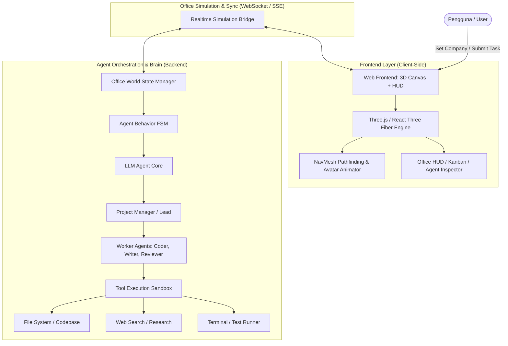
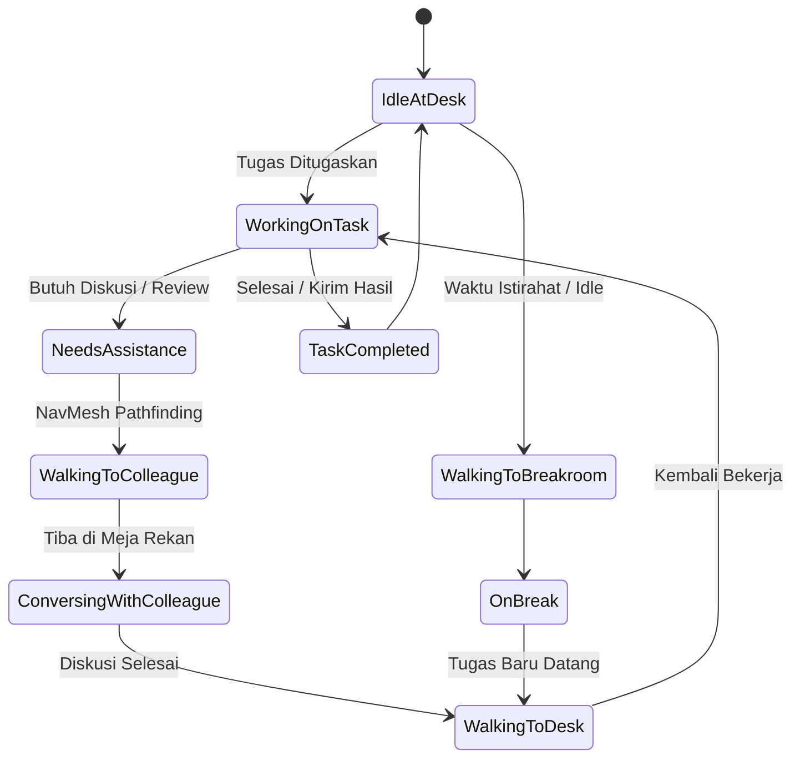

# Real Agent 3D: Autonomous Virtual AI Office

Dokumen ini berisi analisis komprehensif, desain arsitektur, dan roadmap implementasi untuk membangun simulasi kantor virtual 3D interaktif yang dihuni oleh AI Agent otonom yang bekerja secara nyata (coding, content writing, analisa) dengan simulasi fisik menyerupai manusia sungguhan di lingkungan kerja.

---

## 1. Analisis Kebutuhan & Konsep Utama

### 1.1 Visi Produk
Menggabungkan **kedalaman simulasi fisik (seperti The Sims / Game Dev Tycoon)** dengan **kekuatan sistem AI Multi-Agent nyata (seperti AutoGen / CrewAI / Devin)**. Pengguna tidak hanya melihat terminal teks log kaku, melainkan melihat representasi kantor 3D nyata:
- Karyawan (AI Agent) duduk di meja masing-masing sambil mengetik saat bekerja.
- Jika Programmer butuh klarifikasi spesifikasi dari Product Manager, dia akan berdiri, berjalan kaki melintasi koridor kantor menuju meja PM, lalu berbicara.
- Terdapat ruang rapat (Meeting Room) untuk sinkronisasi divisi atau *all-hands*, serta pantry/breakroom untuk jeda istirahat atau brainstorming kasual.
- Seluruh tugas yang dikerjakan menghasilkan output nyata (file kode, draft konten, laporan analisis, commit/diff).

### 1.2 Fitur Inti yang Diinginkan
1. **Perusahaan & Divisi Dinamis (Company Generator)**:
   - Pengguna bisa menentukan nama kantor, memilih jenis industri (e.g. *SaaS Tech Startup, Digital Marketing Agency, Legal/Consulting Firm, Media House*).
   - Opsi **Auto-Generate**: AI menganalisis jenis perusahaan, lalu meng-generate struktur organisasi, divisi, jabatan, deskripsi pekerjaan, persona/avatar masing-masing agent, dan tata letak meja kerja yang sesuai.
   - Opsi **Custom Builder**: Menambah, mengubah, atau memecat agent, mengatur hierarki atasan-bawahan, dan mengatur desk allocation.
2. **Representasi Fisik 3D & Spatial Awareness**:
   - Kantor 3D visual (Stylized Low-Poly / Isometric 3D) yang modern, estetik, dan responsif.
   - Sistem **Pathfinding (NavMesh)**: Agent mengetahui posisi meja kerja, posisi agent lain, koridor, pintu, dan ruang meeting.
   - Interaksi fisik: Berdiri, berjalan (*walking animation*), duduk di kursi (*sitting/working*), mengobrol berhadapan (*chatting animation/speech bubble*).
3. **Komunikasi Antar-Agent Berbasis Role**:
   - Komunikasi formal mengikuti hierarki (Staff $\leftrightarrow$ Team Lead $\leftrightarrow$ Manager $\leftrightarrow$ C-Level).
   - Komunikasi terjadi dengan mekanisme fisik: Agent mengirim sinyal *intent to talk*, berjalan ke target, dan memulai sesi dialog LLM dua arah. Transkrip obrolan muncul di atas kepala agent (speech bubble) dan tersimpan di log kantor.
4. **Pekerjaan Nyata (Real Task Execution)**:
   - **Coding Agent (Software Engineer)**: Mampu membaca project file, menulis kode, memanggil shell/terminal untuk run test, dan membuat PR/diff.
   - **Content Writer**: Riset web, menyusun draft artikel/copywriting, editing, dan mengekspor dokumen Markdown/HTML.
   - **Manager / Project Manager**: Mengurai tujuan (*user objective*) menjadi sub-tasks (kanban tickets), menugaskan agent yang sesuai, mengawasi progres, dan melakukan *code/content review*.
5. **Observability & User Control (HUD / Office Dashboard)**:
   - Klik pada agent untuk membuka **Employee Profile**: melihat task saat ini, state emosi/energi, riwayat chat, dan live screen/terminal apa yang sedang diketik.
   - **Office Kanban Board**: Memantau status tiket (*Backlog, In Progress, In Review, Done*).
   - Speed Control (*1x, 2x, 5x, Pause*) dan mode Free Camera / Follow Agent.

---

## 2. Arsitektur Sistem

### 2.1 State Machine Perilaku Agent (Agent FSM)
Setiap agent memiliki *Life-Cycle State*:

---

## 3. Komponen Teknis & Rekomendasi Stack

| Komponen | Pilihan Terpilih | Alasan & Keunggulan |
| :--- | :--- | :--- |
| **Framework Web** | **Next.js Fullstack (App Router)** | Terintegrasi frontend dan backend API routes dalam satu codebase modern, SSR/client modularity. |
| **Dual Viewport Engine** | **2.5D Isometric Canvas (Default) + 3D WebGL** | **2.5D Isometric** memberikan load instan (<50ms), 60 FPS mulus di laptop biasa tanpa GPU berat, anti-blank, dan presisi klik 100%. User juga bisa beralih ke **3D WebGL** kapan saja. |
| **Pathfinding** | **A* Waypoint Navigation (26x20 Grid)** | Navigasi cerdas agen melintasi koridor kantor tanpa menabrak meja/dinding. |
| **Gaya Visual** | **Modern Tech Startup Office** | Warna dark graphite, partisi kaca, meja pods, floating speech bubble, dan status kerja realtime. |
| **Human-in-the-Loop** | **Owner Executive Desk & Approval Modal** | Agen berjalan ke meja Owner jika butuh keputusan arsitektur/keamanan kritis. |
| **Marketplace & Wallet** | **Creator Economy & Point Top-up** | Sistem rekrut & pecat agen, monetisasi kustom agen, langganan token bulanan, dan dompet poin. |

---

## 4. Mekanisme Komunikasi & Prosedur "Jalan Kaki"

1. **Pemicu (Trigger)**:
   - Misalnya `BackendDev` sedang membuat API, namun menemukan skema database yang belum jelas dari `DatabaseArchitect`.
2. **Pengecekan Ketersediaan**:
   - `BackendDev` mengecek status `DatabaseArchitect` di World State: apakah sedang di meja, sedang meeting, atau sedang di pantry.
3. **Transisi Fisik**:
   - FSM `BackendDev` beralih ke `WALKING_TO_TARGET`.
   - NavMesh menghitung rute dari kursi `BackendDev` menuju sisi meja `DatabaseArchitect`.
   - Karakter berdiri, memainkan animasi jalan kaki, bergerak menyusuri koridor.
4. **Dialog Kontekstual**:
   - Setelah tiba dalam radius interaksi (< 1.5 meter), animasi beralih ke `TALKING`.
   - LLM menjalankan *Turn-Based Dialog*:
     - *Dev*: "Bro, untuk relasi Order ke Invoice butuh one-to-many atau one-to-one?"
     - *Architect*: "Gunakan one-to-many karena 1 order bisa ada split invoices."
   - Bubble percakapan muncul di atas kepala keduanya secara realtime.
5. **Kembali & Melanjutkan**:
   - `BackendDev` berbalik arah, berjalan kembali ke mejanya, duduk, dan melanjutkan eksekusi kode sesuai jawaban yang didapat.

---

## 5. Rencana Tahapan Pengembangan (Development Roadmap)

### Tahap 1: Pondasi & Lingkungan 3D Office (Milestone 1)
- [ ] Inisialisasi struktur project (Frontend 3D + Server Orchestrator).
- [ ] Pembuatan Layout Kantor 3D: Lantai, dinding kaca, meja kerja, kursi, tanaman hias, ruang meeting, dan pantry.
- [ ] Sistem Kamera: Orbit controls, Isometric view, zoom in/out, dan follow agent mode.
- [ ] Sistem NavMesh / Grid Pathfinding: Karakter 3D dapat bergerak dari titik A ke titik B menghindari rintangan meja dan dinding.

### Tahap 2: Manajemen Perusahaan & Agen Dinamis (Milestone 2)
- [ ] Model data Company (`name`, `industry`, `departments`, `agents`, `deskLayout`).
- [ ] **AI Company Generator**: Form sederhana di mana user memasukkan:
  - *Nama Perusahaan* (e.g. "DevNexus Labs")
  - *Industri* (e.g. "Web & Mobile Development Agency")
  - Generator otomatis merancang struktur tim (PM, UI/UX, Frontend, Backend, QA) beserta deskripsi, avatar color/model, dan meja kerja.
- [ ] Integrasi visual: Agen di-spawn di kantor dan duduk di meja masing-masing dengan name tag di atas kepala.

### Tahap 3: Logika Perilaku & Interaksi Fisik (Milestone 3)
- [ ] Implementasi Agent FSM (*Idle, Walking, Working, Chatting, Meeting*).
- [ ] Mekanisme Request Collaboration: Agen berjalan menghampiri meja rekan saat butuh diskusi.
- [ ] Visual Speech Bubble & Live Audio-Visual feedback (animasi ketik, suara ketikan keyboard pelan, bubble chat).
- [ ] Rapat Tim (Meeting Room): Agen-agen dari divisi yang sama berjalan ke ruang rapat saat dipanggil oleh Manager untuk *sprint planning* atau *review*.

### Tahap 4: Eksekusi Tugas Nyata (Real Task Capabilities) (Milestone 4)
- [ ] **Task Manager & Kanban**: User memberikan tugas umum (misal: *"Buat landing page portofolio dan tulis copywriting kontennya"*).
- [ ] Manager memecah tugas menjadi sub-tasks.
- [ ] Coder Agent mengeksekusi pembuatan file nyata di workspace menggunakan tools filesystem.
- [ ] Writer Agent membuat artikel/konten dan menyimpannya ke folder output.
- [ ] Inspektur Agent: User dapat mengklik agent mana saja untuk melihat *"Screen"* / log terminal apa yang sedang dikerjakannya saat itu juga.

### Tahap 5: Finishing & Fitur Lanjutan (Milestone 5)
- [ ] Customization mode (seret/atur posisi meja di kantor).
- [ ] Dark mode & aesthetic lighting (ambient light, bloom effect, bayangan lembut).
- [ ] Ekspor & Impor konfigurasi kantor (JSON file).
